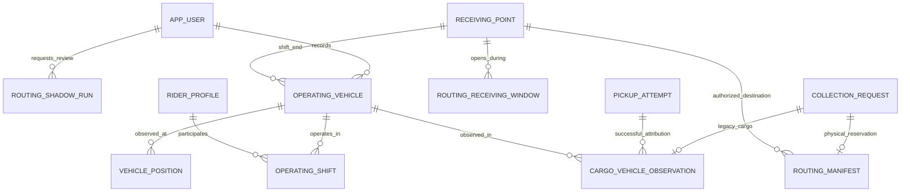
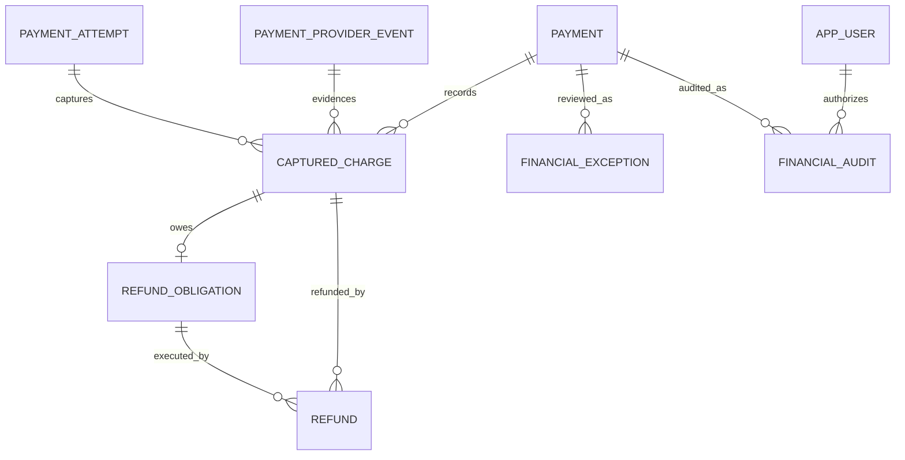
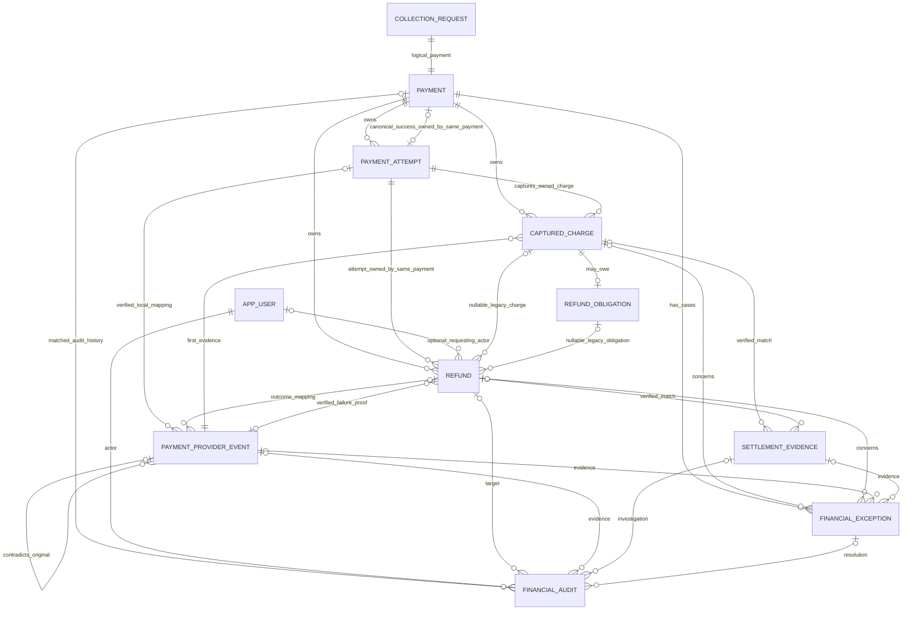
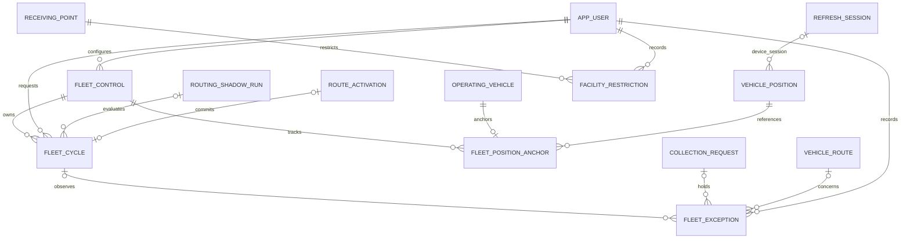

# ER Diagram

Increment 8 adds `OperatingRegion -> FleetControl` (unique region FK),
`OperatingShift -> ShiftConfirmation -> RiderProfile`, and
`FleetCycle / CollectionRequest / OperatingRegion -> PlanningOutcome` with a
`(cycle_id, request_id)` primary key. Wake scope identifies the regional owner; outcome
and confirmation history are immutable. Composite selection JSON remains optimization
provenance and does not replace any assignment, pickup, custody or payment relationship.

This file contains the consolidated relationship view for quick review.

For entity semantics, see `DOMAIN_MODEL.md`.

For physical table/constraint details, see `SCHEMA_DESIGN.md`.

```mermaid
erDiagram
    APP_USER ||--o{ USER_PHONE : has
    APP_USER ||--o{ USER_ROLE : has
    APP_USER ||--o{ REFRESH_SESSION : owns
    APP_USER ||--o{ USER_ADDRESS : saves
    APP_USER ||--o| RIDER_PROFILE : may_be

    APP_USER ||--o{ SERVICEABILITY_CONTEXT : creates
    USER_ADDRESS ||--o{ SERVICEABILITY_CONTEXT : may_source

    APP_USER ||--o{ COLLECTION_REQUEST : places
    SERVICEABILITY_CONTEXT ||--o| COLLECTION_REQUEST : produces
    COLLECTION_REQUEST ||--|{ COLLECTION_REQUEST_ITEM : contains

    COLLECTION_REQUEST ||--|| PAYMENT : payable_by
    PAYMENT ||--o{ PAYMENT_ATTEMPT : attempted_through
    PAYMENT_ATTEMPT ||--o{ PAYMENT_PROVIDER_EVENT : receives
    PAYMENT ||--o{ REFUND : may_have
    REFUND ||--o{ PAYMENT_PROVIDER_EVENT : receives

    PLANNING_BATCH ||--o{ PLANNING_BATCH_ATTEMPT : executed_as
    PLANNING_BATCH ||--|{ COLLECTION_REQUEST : freezes
    PLANNING_BATCH ||--|{ COLLECTION_GROUP : produces
    COLLECTION_GROUP ||--|{ COLLECTION_GROUP_MEMBER : contains
    COLLECTION_REQUEST ||--o| COLLECTION_GROUP_MEMBER : planned_into

    FLEET ||--o{ FLEET_MEMBERSHIP : has
    RIDER_PROFILE ||--o{ FLEET_MEMBERSHIP : joins
    RIDER_PROFILE ||--|| RIDER_AVAILABILITY : current_state

    COLLECTION_GROUP ||--o{ ASSIGNMENT_OFFER : offered_as
    RIDER_PROFILE ||--o{ ASSIGNMENT_OFFER : receives

    COLLECTION_GROUP ||--o{ RIDER_ASSIGNMENT : assignment_history
    RIDER_PROFILE ||--o{ RIDER_ASSIGNMENT : performs

    COLLECTION_REQUEST ||--o| PICKUP_EXECUTION : fulfilled_by
    COLLECTION_GROUP ||--|{ PICKUP_EXECUTION : groups

    RIDER_ASSIGNMENT ||--|{ RIDER_ASSIGNMENT_ITEM : contains
    PICKUP_EXECUTION ||--o{ RIDER_ASSIGNMENT_ITEM : assigned_through

    PICKUP_EXECUTION ||--o{ PICKUP_ATTEMPT : attempted
    RIDER_ASSIGNMENT ||--o{ PICKUP_ATTEMPT : performed_under
    PICKUP_EXECUTION ||--o{ PICKUP_INCIDENT : may_raise
    RIDER_ASSIGNMENT ||--o{ PICKUP_INCIDENT : attributed_to

    APP_USER ||--o{ EVIDENCE_CAPTURE : captures
    EVIDENCE_CAPTURE ||--o| MEDIA_ASSET : has_original
    PICKUP_EXECUTION ||--o{ PICKUP_EVIDENCE_LINK : evidenced_by
    EVIDENCE_CAPTURE ||--o| PICKUP_EVIDENCE_LINK : may_support

    RECEIVING_POINT ||--o{ HANDOVER_EVENT : receives
    RIDER_PROFILE ||--o{ HANDOVER_EVENT : performs
    HANDOVER_EVENT ||--|{ HANDOVER_EVENT_ITEM : contains
    PICKUP_EXECUTION ||--o{ HANDOVER_EVENT_ITEM : handed_over_by

    HANDOVER_EVENT ||--o{ HANDOVER_EVIDENCE_LINK : evidenced_by
    EVIDENCE_CAPTURE ||--o| HANDOVER_EVIDENCE_LINK : may_support
```



Phase 1L creates exactly one pickup or handover link per EvidenceCapture through its
transaction-owned service. Each link table has `UNIQUE(evidence_capture_id)`; no polymorphic target
columns or cross-table trigger are used. MediaAsset is an independent optional storage lifecycle.

Phase 1M freezes the media relationship as zero or one original `MediaAsset` per
`EvidenceCapture`, enforced by `UNIQUE(media_asset.evidence_capture_id)`. Derived representations
remain future work.

Phase 1O implements the identity relationships at the top of the graph. `user_phone` permits one
active verified phone per user and one active owner per keyed phone lookup. `user_role` retains
grant/revocation history with active uniqueness per role. `refresh_session` permits multiple fixed-
expiry, independently revocable sessions per user and stores only a unique SHA-256 credential
verifier.

## V2 operational inputs — migration 0024



Each input also records its AppUser recorder. OperatingShift has unique open rider/vehicle
bindings. RoutingShadowRun embeds versioned problem/result documents, with no assignment
or custody FK authority. Its source projection spans existing group/cell/slot boundaries.
See [implemented boundary](V2_ROUTING_INCREMENT_3.md).

## V2 operational authority — migration 0025

~~~mermaid
erDiagram
    ROUTING_SHADOW_RUN ||--o| ROUTE_ACTIVATION : authorizes_once
    APP_USER ||--o{ ROUTE_ACTIVATION : activates
    OPERATING_VEHICLE ||--o{ VEHICLE_ROUTE : operates
    OPERATING_SHIFT ||--o{ VEHICLE_ROUTE : binds
    RIDER_ASSIGNMENT ||--o| VEHICLE_ROUTE : performs
    VEHICLE_ROUTE ||--|{ ROUTE_REVISION : revises
    ROUTE_ACTIVATION ||--o{ ROUTE_REVISION : commits
    VEHICLE_ROUTE ||--o{ ROUTE_TASK : executes
    ROUTE_REVISION ||--|{ ROUTE_REVISION_STOP : orders
    ROUTE_TASK ||--o{ ROUTE_REVISION_STOP : retains
    PICKUP_EXECUTION ||--o{ ROUTE_TASK : fulfils
    RECEIVING_POINT o|--o{ ROUTE_TASK : discharges_at
    VEHICLE_ROUTE ||--o{ ROUTE_RECOVERY : recovers
    HANDOVER_EVENT ||--o| ROUTE_DISCHARGE_PROOF : substantiates
    ROUTE_TASK ||--o{ ROUTE_DISCHARGE_PROOF : attempts
    EVIDENCE_CAPTURE ||--o| ROUTE_DISCHARGE_PROOF : photo_capture
~~~

New V2 pickups/assignments need no CollectionGroup; retained V1 rows keep that relationship.
Completed pickup/assignment attribution survives revision and recovery. Rejected discharge
proofs can precede one validated whole-lot handover. See [authority](V2_ROUTING_INCREMENT_4.md).

## Cross-cutting reliability tables

Phase 1R `AUTHENTICATION_CHALLENGE` is a standalone authentication-intent root before user
resolution, with no AppUser FK. It binds a protected phone identity to a transaction-bound provider
reference; its public challenge UUID is separate. Only committed login consumes it. Its lifecycle
and constraints are defined in `SCHEMA_DESIGN.md`.

These are intentionally not shown in the business ER graph:

```text
IDEMPOTENCY_RECORD
INBOX_MESSAGE
OUTBOX_EVENT
```

They are reliability infrastructure rather than business aggregates.

See `IDEMPOTENCY.md`.

Phase 2 Batch B preserves all financial relationships: one logical Payment per collection,
attempt history, provider events and canonical-charge Refunds. Nullable authenticated capture
reference/amount/currency on PaymentProviderEvent retain additional-charge reconciliation facts;
they do not introduce a second financial aggregate or relax the canonical refund/balance invariant.
`PENDING_PAYMENT -> CANCELLED` is now an approved lifecycle edge, alongside accepted cancellation.
Cancellation compensation and later canonical capture use the existing Refund/outbox relationship.


## Phase 2 charge accounting extension



Migration 0020 adds these typed relationships. Legacy Refund links remain nullable until
verified; no generic polymorphic financial references or guessed backfill are introduced.
Charge-level bounds supersede the historical Batch B combined canonical-only cap.

## Migration 0021 financial evidence and ownership relationships



Composite Attempt/Payment ownership FKs protect canonical success, captures and refunds.
All nullable endpoints above denote optional real FKs, including unmatched external settlement
observations. FinancialScanCheckpoint is standalone account/window control progress, unique by
provider/account/kind, without a polymorphic entity reference. Inbox, Outbox and IdempotencyRecord
remain cross-cutting infrastructure. No relationship uses cascading financial deletion.

## Increment 5 continuous fleet relationships



Nullable exception endpoints are real FKs with at least one target required.
Policy JSON and measured cost JSON do not replace these relationships. Task commitment
and resource blocks extend existing entities; they do not change custody-ledger edges.

## Increment 7 relationships

OperatingRegion owns cell/vehicle/receiving membership and designates an authorized warehouse.
Admission belongs to customer/context; reservation belongs to region/customer/context and
optionally binds booking. AppointmentConsent joins booking/customer/reserved window. Receipt
and delivery reference RouteRevision. Flexible offers/commitments reference shifts and their
business admission/booking. Reattempt links attempt/evidence; authorization links its anchor.
Break/extension/availability reference shift. Discharge amendments and load observations
reference request/actor/evidence. Transfer intent names request/from-vehicle/to-shift/authorizer
and write-once resolution. Receipts identify signer/witness and capture. Transfer retains
donor/receiver vehicles/riders, evidence, authorizer and confirmer in monotonic custody order.
