# V2 routing increment 8 — regional parallel planning

Implementation branch: `codex/v2-regional-parallel-routing`.
Base: `6510ade1ee416ae78a8a86681bcbfe18fa387a00` (merged increment 7). Production flags remain false. No PR, deployment,
paid dependency, cloud resource, external worker deployment or recurring service is introduced.


## Code map

| Boundary | Implementation |
|---|---|
| Finite regional owner, admission, neighbourhoods, refresh, atomic outcome completion | `src/tirodhan/modules/routing_operations/regional_planner.py` |
| Transportable workers, complete-route candidates, contested removals, CP-SAT and provenance gate | `src/tirodhan/modules/routing_operations/parallel.py` |
| Per-execution directed coordinate cache | `src/tirodhan/modules/routing_operations/regional_matrix.py` |
| Typed confirmation/outcome records and schema | `parallel_models.py`, migration `0028_regional_parallel_routing.py` |
| Authoritative composite activation and mandatory source fence | existing `authority.py` and `snapshot.py` |
| Independent shared facility check | `src/tirodhan/modules/planning/routing/facilities.py` |
| Supervised private OSRM, bounded worker entry, disabled/error boundaries | `src/tirodhan/workers/routing_regional.py` |
| Wake targeting, regional certificate policy, existing cancellation/recovery integration | existing `orchestration.py`, `admission.py`, `regional_projection.py`, `destinations.py`, `reconciliation.py` |
| PostgreSQL/native/runtime/schema and performance evidence | `tests/integration/test_regional_parallel*.py`, `tests/routing/test_regional_selection.py`, `test_regional_runtime.py` |

```mermaid
flowchart LR
    Facts[(PostgreSQL facts and regional wake)] --> Owner[Claim regional lease]
    Owner --> Snapshot[Consistent source snapshot and admission]
    Snapshot --> Roads[Private OSRM and directed matrix cache]
    Roads --> VROOM[Bounded VROOM workers]
    Roads --> Routing[Bounded OR-Tools Routing workers]
    VROOM --> Pool[Validated complete routes and removal alternatives]
    Routing --> Pool
    Pool --> Select[Hybrid CP-SAT selection]
    Select --> Refresh[Refresh positions and completed work]
    Refresh --> Repair[Validate and reselect complete routes]
    Repair --> Gate[Independent live feasibility and source fence]
    Gate --> Commit[(Atomic authority, outcomes and captured-generation ack)]
```



## Implemented execution

One finite owner claims `REGION:<region UUID>` in PostgreSQL. Region membership remains
relational; cells describe membership, not route boundaries. The old global writer cannot
claim while regional owners are configured. Existing V1 historical execution/drain remains.

The owner performs existing receipt/deadline preflight, regional cancellation cleanup and
bounded authorized destination recovery. It captures one consistent regional source snapshot,
retains required ownership/cargo/reservations, and selects a bounded candidate population.
Discovery and candidate admission are distinct from customer booking capacity certification.
Discovery, candidate, matrix, native process and CP-SAT limits are explicit technical bounds;
exceeding them is not proof of physical infeasibility and cannot drop an accepted booking.

Only rider-confirmed active committed shifts supply operational capacity. `SHIFT_CONFIRM`
is a rider-owned, idempotent pre-shift operation through the existing operational endpoint.
No historical manager attestation is silently converted into rider confirmation. Existing
unconfirmed shifts must drain before adoption or use subsequent properly confirmed shifts.
Route receipt is not acceptance/rejection. Flexible offers/acceptance retain their separate
protocol and eligibility; new flexible work is never inferred from availability alone.

The versioned hybrid objective preserves mandatory obligations as hard constraints, promotes
waiting-age escalations, prioritizes urgent eligible reattempts and lead-time-critical work,
then maximizes general coverage and minimizes independently measured fleet cost. Committed
capacity retains priority over supplementary capacity. Each priority level is optimized and
fixed only after a proof of optimality; a time-limited feasible result is reported as such.
This is not a generic urgency-weighted sum and does not prove optimality over all possible
routes. Candidate admission uses urgency, waiting age, reachability, physical capacity,
service/unload estimates, remaining windows and breaks; a multiplier expands the engineering
estimate, never establishes a customer promise. There is no production multiplier default.

Worker neighbourhoods use reachable trajectories after protected prefixes, plausible riders,
balanced spatial-temporal seeds and bounded border overlap. Each resource also has a bounded
nearest-rider pair search, permitting unprotected future commitments to change riders through
existing transactional transfer rules. Core/expanded inputs and both
engines generate bounded alternative complete routes. VROOM remains for its faithful supported
projection; OR-Tools Routing supports cargo/unload cases beyond VROOM's capability. Neither
engine can reset unidentified cargo or establish a handover. Cargo is discharged by identified
lot at authorized points, with service, opening and custody limits preserved.

Local workers use a bounded spawn-based process pool and finite native children. Task/result
JSON includes versioned immutable routing projections and matrices, not localhost endpoints,
coordinator files or shared-memory names. The same transport contract can support external
containers later, without introducing them now. VROOM is single-threaded per task; native
search/process output and execution budgets remain enforced. There is no native Top-K claim.

Contested optional bookings produce bounded removal alternatives: remove pickup and discharge
together, retain incumbent/protected/custodied work, preserve remaining order, and independently
recalculate/validate the route. Originals and alternatives enter the same CP-SAT pool. No route
is spliced after selection. A truncated pool is not a proof that no better alternative exists.

CP-SAT chooses exactly one alternative per participating vehicle/rider, including valid idle/
incumbent routes; each optional booking is used at most once and mandatory lots exactly once.
It has no stop-order optimization variables. Shared receiving-point unload quotas are optional,
explicit master data, not guessed physical facility capacity. Fixed candidate schedules and
other active routes' reservations are checked during selection and independently again under
SERIALIZABLE activation, including after passive capacity visits are removed. Such quotas are
Tirodhan planning limits, not a reservation of government facilities against external traffic.

## Roads and bounded memory

The regional CLI supervises one private loopback OSRM process per required graph/profile and
reaps every child on exit/failure. Graph processes start lazily after a successful regional
claim and only when road data is actually needed; no-due/no-capacity invocations do not load
unused graphs. Occupied loopback ports fail closed. Car and bicycle graphs are distinct. The runtime verifies
OSRM 6.0.0; graph/profile provenance is explicit configuration. `RegionalMatrixCache` deduplicates
coordinates for road acquisition while retaining household IDs and service times. Directed
durations/distances are scoped to the execution and attested graph/profile. Global, bounded
zonal block and on-demand pair acquisition are available for measurement. Immutable submatrices
are extracted for solver tasks; workers do not independently call OSRM. “Zonal” means
bounded table blocks, not omission of cross-neighbourhood roads. The common contract still
materializes a dense matrix for the admitted population; its representation remains quadratic
in that population. The on-demand comparison acquires missing directed pairs into that same
contract, not a sparse matrix that pretends unknown roads are unreachable.

JSON/native structures still copy data. This increment does not claim zero-copy native solver
memory. Pair count, admitted population, matrix size, worker count, candidate generation and
search time remain bounded. A large graph can dominate memory/cold start; clipped-fixture
measurements do not size a full Delhi deployment. Production graph packaging and CPU/memory
calibration remain release gates. Local test packaging preserves OSRM's pinned musl runtime
separately from the Debian solver runtime; it is not a new production image decision.

## Authority, recovery and replay

Mixed routes use `COMPOSITE` construction provenance, not a fictitious winning native engine.
The selection envelope records pool digest, selected candidates, native versions, adjustment
lineage, policy and CP-SAT statuses/bounds. Activation checks candidate facts against the stored
problem and revalidates current source facts, elapsed time, physical feasibility and ownership.
Before publication, the coordinator recaptures positions and execution progress, removes only
completed/cancelled obligations from previous complete-route sequences, recomputes feasibility
and costs, and reselects among refreshed selected routes and valid current incumbents. It stores
prior problem/selection lineage and checks the rebase sequence and engine provenance at activation.
The final transaction still fences selected demand and every live owned/cargo obligation,
capacity hold, resource and facility input. Unrelated new optional arrivals do not repeatedly
invalidate publication: they retain a later wake generation and are discovered by the next job.
The original complete discovery digest and per-booking inputs remain auditable. SERIALIZABLE/deadlock/source conflicts retry
within the configured publication budget without rerunning the long native searches. Exhaustion
leaves the wake pending. Newly arriving optional demand remains for its later generation. A new
unsafe incident during publication aborts for targeted hold/recovery on the next finite execution.
An invalid unchanged incumbent is held through existing safety mechanisms while healthy resources
continue. Explicitly authorized new cargo/recovery obligations may establish a validated native suffix.
Manager-authorized resume and revision-scoped advisory ETA publication retain the existing protocols.
Existing Payment-first resource locking and stable pickup/revision/custody mechanisms remain.

Activation, per-booking relational outcomes, terminal cycle and acknowledgment of the captured
wake generation commit atomically. Deferred bookings receive explicit retry times/reasons;
their outcome is not assignment. A newer generation survives older completion. Failed or expired
owners cannot acknowledge or activate; source changes preserve recoverable work. A wake is a
coalesced hint rather than a per-order completion ledger. Periodic due checks remain necessary
for time progression and replay of durable backlog even without a new incoming message.

All source bookings in the captured working set receive an outcome. Discovery-limit failures
leave the generation pending; they do not report a truncated scan as successful completion.
Outcome history is append-only and requires operational retention sizing before sustained use.
No purge is enabled. At 2,000 unchanged input bookings and one cycle per minute, a full per-cycle
outcome ledger would write up to 2.88 million rows/day; this arithmetic is a retention/operating-cost
risk, not a measured production rate. Waiting-age queries use the current booking population and
its request/time index rather than aggregate every historical booking in the region.
Commercial admission resolves an adopted region's policy without requiring the retired global
writer. Its existing independent certificate algorithm and small working-set bounds remain;
the 2,000-booking benchmark bulk-seeds accepted paid histories, not 2,000 successful customer
checkout/admission calls. Scaling that certificate path is a separate release gate and must retain
its capacity promise. The old cross-region working-set guard remains only for the legacy owner;
adopted owners check their own region. No financial-provider or checkout logic is modified.
Production cutover must configure every intended regional owner/job and
drain incompatible active shifts before retiring the old global scheduling entry point.

## Validation and measurements

Pinned versions: VROOM **1.15.0**, OR-Tools **9.14.6206**, OSRM **6.0.0**.
The local fixture is the checked-in public clipped Delhi map, not a full-city or live-traffic
dataset. Dense pilots reuse four public locations; the final varied-coordinate fixture uses
64 sampled public OSM road vertices, retaining separate household identities after
road snapping. The fixture provenance and deterministic sampling are documented in
[the public-data manifest](../tests/routing/data/README.md). Benchmarks use explicit synthetic
capacity, service times, windows and policy coefficients. Resource sampling covers the isolated
planner process tree including local OSRM/native children; PostgreSQL is a separate container.

Initial smoke measurement (before the final campaign): 2,000 bookings / 20 riders, two worker
processes, 80 admitted candidates, 29.80 seconds; 80 assignments and 1,920 durable deferrals.
This was a technical candidate ceiling, not proof that only 80 bookings were serviceable.

The completed campaign contains **19 successful complete executions**. The planner container
was limited to 2 CPUs / 4 GiB and disposable PostgreSQL to 2 CPUs / 1 GiB. The following
matrix comparisons use the fast synthetic 30/30-second service fixture:

| Strategy | Samples | Median total | Empirical P95 / P99 | OSRM calls | Assigned / deferred |
|---|---:|---:|---:|---:|---:|
| Global | 5 | 66.70 s | 70.71 / 70.71 s | 1 | 160 / 1,840 |
| Zonal blocks | 5 | 68.29 s | 70.78 / 70.78 s | 2 | 160 / 1,840 |
| Cached on-demand pairs | 5 | 465.96 s | 692.92 / 692.92 s | 2,279 | 160 / 1,840 |

Quantiles use nearest rank; with five observations P95 and P99 are the observed maximum.
On-demand runs ranged from 248.88 to 692.92 seconds. Their variability is recorded without
claiming a verified low-level cause. All 15 runs used 19 of 20 riders, traveled 133,242 m,
and measured fleet cost 22,826 generalized seconds under the explicit synthetic coefficients.
Native failures and native timeouts were zero. Recorded final repair CP-SAT stages were
OPTIMAL for their submitted pools; this is not proof of a global routing optimum.

| Global comparison | Samples | Total | Assigned / deferred | Used riders | Fleet cost seconds |
|---|---:|---:|---:|---:|---:|
| One worker, 160 admitted | 1 | 102.41 s | 160 / 1,840 | 19 | 22,826 |
| Two workers, 80 admitted | 1 | 63.02 s | 80 / 1,920 | 19 | 15,987 |
| Two workers, 320 admitted | 1 | 74.84 s | 320 / 1,680 | 20 | 35,531 |
| Two workers, 160 admitted, regional service minima for new demand | 1 | 57.38 s | 159 / 1,841 | 20 | 26,684 |

The last case uses configured 180-second pickup and 60-second discharge for the 1,998 new
records; two earlier immutable fixture manifests retain their original service facts. Its
single unselected admitted booking is not a proof of physical infeasibility. The lower total
is one observation with a different search problem, not evidence that longer service is faster.
One-worker versus two-worker samples suggest lower wall time from concurrency here, while
sampled CPU work remains about 79 CPU-seconds. They do not establish a general speedup.

The maximum aggregate process-tree RSS / sampled cgroup usage was 486.1 / 337.0 MiB for
global, 484.7 / 336.6 MiB for zonal, and 617.8 / 339.8 MiB for on-demand. RSS sums shared
pages across processes and is not unique physical memory; repeated test cases retain parent
Python allocations. Sampled peak CPU was usually around 2.55 cores, with one 4.61-core outlier despite
the 2-CPU quota. This short-interval process estimator is subject to burst/sampling artifacts;
these values are not evidence of sustained allocation or reliable hardware peak sizing.
Database campaign sampling at approximately four-second intervals observed 169.8 MiB and
48.74% CPU; it includes fixture preparation and can miss short peaks. It is separate from
planner process measurements.

Full per-run aggregates, stage timings, CPU/RAM and cost ranges are retained in
[the machine-readable results](benchmarks/V2_ROUTING_INCREMENT_8_RESULTS.json). Empirical P95/P99 from a small synthetic campaign must not be
represented as production tail-latency guarantees. Benchmark coverage, fleet cost and utilization
must be considered alongside latency, because restricted candidates trade quality for bounded
compute. No parallel speedup or city-scale throughput is assumed.

## Release boundaries

Production remains disabled. External workers, paid routing, always-on road servers, Redis,
additional databases and cloud provisioning are absent. The next reviewed work should calibrate
candidate diversity/quality, actual city/profile graphs, operational deadlines and storage cost
from representative demand, then review a complete cutover/release plan. No later increment is
authorized or started by this delivery.

Fixed candidate facility schedules can miss feasible routes requiring extra discretionary waiting;
CP-SAT proves only submitted-pool objectives. Shared receiving-point locks can serialize short
publications across regions using that point. This increment does not claim conflict-free concurrent
facility commits. Mandatory working-set overflow, discovery/road memory limits and exhausted repair
remain explicit retry/recovery failures; no accepted work is pruned to make a limit fit. Current
technical ceilings (including discovery, admitted demand and vehicle/node limits) are safeguards,
not evidence of unlimited regional scale. Operational calibration must test them with real geography.


## Configuration and remaining operational gaps

Regional CLI configuration initializes one immutable policy identity; exact concurrent initialization
converges on one row/wake. It is not a general audited regional-policy update or membership-management
API. Calibrated live changes require a reviewed versioned administrative workflow. Historical V1
execution drains, frontend/push consumers and physical receiving-point operations retain their
existing separate release prerequisites. No automatic historical rider confirmation is introduced.

The accepted-flexible test independently exposed an old unconditional committed-only activation
guard. The regional path now permits active, explicitly accepted supplementary capacity; the same
independent booking eligibility and source checks prevent assignment of unaccepted flexible work.
Bounded voluntary offers also remain available when no confirmed committed capacity is currently
usable. Neither an offer nor receipt establishes assignment authority.

## Observed road-provider failure

An artificial 64-position jitter fixture returned OSRM `Ok` but contained **69 negative
(non-diagonal) distance cells**, with no negative durations, no invalid diagonals and maximum
snap distance 34.79 m. The unchanged strict OSRM provider rejected the response with
`INVALID_ROAD_MATRIX`; the benchmark failed before activation. This is a reproducible raw
pinned-provider observation, not a claim that coordinate jitter itself explains the bug.
The final benchmark samples public road vertices independently of those responses; a
combined 72-position diagnostic returned no negative cells or invalid diagonals, with
maximum snap 144.44 m. All final benchmark requests still pass the normal strict provider.

There is no invented zero/straight-line matrix correction or fallback to paid routing.
Production graph/profile qualification must investigate this OSRM distance-annotation
failure and choose a verified provider fix/upgrade or bounded real-road recovery strategy
before activation. Current behavior fails closed, leaves the generation pending and retries;
it does not guarantee successful matrix acquisition for every geographically valid input.

## Validation environments and known failures

The complete default Python 3.12 dependency suite passed: **1,343 passed, 47 skipped,
4 warnings, 1,464.61 s**. Optional native routing/property campaigns and explicit benchmarks
are intentionally opt-in in that environment.

The complete Python 3.13 native environment run produced **1,400 passed, 11 skipped,
3 failed, 6 warnings, 1,418.82 s**. Two existing `test_native_collective_fleet_and_moving_cargo`
cases hit `MATRIX_TIMEOUT`; all three parameter cases passed on isolated rerun (14.73 s),
without changing the provider timeout or test assertions. Their full-run timing failure was
not reproduced in isolation; a definitive environmental cause is not claimed.
The existing `test_timeout_traceback_and_http_logging_hide_sensitive_url` failed in Python
3.13, reproduced on an isolated archive of unchanged base `6510ade`, and passed under Python
3.12. No OTP implementation or assertion was modified. The native full-run failures must
not be presented as an all-green run.

The final affected-code run passed **43 tests in 62.55 s**, covering regional concurrency,
both native engines, public-profile runtime and migration history (Hypothesis seed 81016).
Final Ruff lint and formatting checks passed (410 files already formatted); mypy passed
for all 203 source files. Both dependency environments passed pip check. The default-runtime
boundary check separately passed 5 tests with 1 optional-runtime skip in 2.69 s. Strict schema comparison retains the **two** known application
index/metadata differences and catalog-owned extension exclusions from the base helper; it
continues checking real application drift, the two index definitions and PaymentAttempt defaults.
Migration 0028 round trips populated payment/attempt history and retains all three initiation-term
triggers. It refuses destructive downgrade after confirmation/outcome/composite adoption.

The regional CLI emits controlled status/error-type diagnostics, never raw exception strings
or tracebacks that could disclose SQL/road inputs. Its default-disabled flags are tested before
any database/native runtime opens. Waiting-age escalation remains active even without confirmed
capacity, and deduplicates manager attention while retaining durable deferrals.

The performance fixture starts with idle vehicles and no initial cargo. Native routes can require
intermediate unloading because each new synthetic lot is 2 kg / 2 L and vehicles carry 10 kg / 10 L.
The matrix/worker comparison uses explicit fast synthetic 30-second pickup and discharge values;
these are not production service calibration or the regional booking API minima. A separate
sensitivity case uses the configured regional minima for new demand. Two pre-existing historical
fixture manifests retain their original facts. Moving cargo, protected execution, breakdowns,
completion during optimization and witnessed recovery are covered by separate functional tests;
the performance campaign does not characterize every busy-fleet history or customer checkout load.

The existing `COMMITTED_DISPATCH` assignment source remains the common vehicle-bound V2
persistence marker. It is not used to convert supplementary fleet classification: the durable
shift remains `FLEXIBLE`, and its separate accepted commitment remains necessary for eligibility.
The flexible regression also constrains admission to one booking and accepts the newer offer,
so older ineligible demand cannot consume its usable candidate budget.

## Reproduction

Integration fixtures truncate application tables. Use only disposable PostgreSQL/PostGIS.
The new local harness builds pinned native images/graphs, creates isolated resources without
host ports, and cleans up its own container/volume. The campaign was executed with equivalent
direct Docker commands; the harness itself receives a PowerShell syntax check.

```powershell
# Default API dependency environment, with a disposable bootstrapped PostGIS test URL:
pytest -q tests -p no:cacheprovider
ruff check .
ruff format --check .
mypy src
pip check

# Local native/PostGIS harness; cached images can use -SkipBuild.
powershell -NoProfile -File tests/routing/run-regional.ps1 -SkipBuild
powershell -NoProfile -File tests/routing/run-regional.ps1 -SkipBuild -FullSuite
powershell -NoProfile -File tests/routing/run-regional.ps1 -SkipBuild -Benchmark -Repeats 5 -Coordinates varied -ServiceMode synthetic_fast
powershell -NoProfile -File tests/routing/run-regional.ps1 -SkipBuild -Benchmark -Repeats 1 -Coordinates varied -ServiceMode regional_minimum
```

The one-worker and ceiling comparisons use `-Processes 1`, `-Admitted 80`, or
`-Admitted 320`; select only the global parameter case for the recorded one-sample comparisons.
Native/postgres focused validation uses Hypothesis seed **81016**.
The public negative-distance diagnostic is reproducible inside the pinned image with
`python tests/routing/probe_regional_matrix.py /graphs/car/map.osrm` and the graph volume mounted.
It reproduced the strict rejection and aggregate counts recorded above.

Production recommendation: retain bounded block acquisition; reject the measured pair-query
strategy for this workload. Native task generation dominates the block-based runs; CP-SAT is
not the measured bottleneck here. Optimize candidate diversity/native startup and qualify full
city/profile graphs before deciding whether external workers justify infrastructure changes.
The next reviewed increment should address the observed provider failure, bounded commercial
certificate scaling, versioned regional administration, and outcome/decision retention cost,
then qualify busy-fleet operations and a complete controlled cutover. No next increment is
implemented, deployed or authorized by this delivery.

Ended shifts retain unhanded cargo and pending ownership in explicit recovery. The regional
projection includes custody on configured vehicles even after their shift expires; it does not
make that vehicle available. A real PostgreSQL regression extends a healthy rider with explicit
rider consent/manager authorization, preserves the ended rider's collected attempt and custody,
and verifies that the healthy rider can receive new work.

| Median phase, fast service / two workers / 160 admitted | Global | Zonal | On-demand |
|---|---:|---:|---:|
| Snapshot/admission | 0.68 s | 0.82 s | 0.69 s |
| Matrix acquisition | 0.26 s | 0.42 s | 398.33 s |
| Worker processing | 61.41 s | 62.60 s | 61.99 s |
| Conflict alternatives and initial CP-SAT | 0.20 s | 0.19 s | 0.19 s |
| Publication refresh/reselection | 0.22 s | 0.22 s | 0.23 s |
| Validation, activation and advisory ETA publication | 3.69 s | 3.63 s | 3.72 s |

Phase medians are independent summaries and need not sum to the total median; total also includes
startup/audit persistence and other measured overhead. The full suites preceded final targeted
hardening. Affected-code checks were rerun afterward, rather than claiming the initial native
full run was clean or rerunning unrelated financial tests after each local correction.
